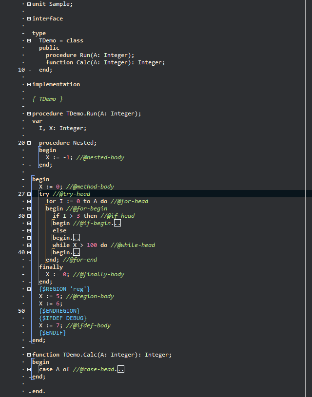

# CS.Coder Block Folding (beta)

> [!WARNING]
> **BETA VERSION.** CS.Coder Block Folding is in beta: it is still being tested and may have defects.
> It does not change your source files, but it works inside the code editor: save your
> work often while you try it.
> Please report anything you find by opening an
> [issue](https://github.com/cscoder69/delphi-block-folding/issues).

**English** | [Português (Brasil)](README.pt-BR.md)

**Version:** 0.26.10.12a (beta) · **License:** [MIT](LICENSE.txt), free and open source ·
**Delphi:** 11, 12 and 13 · [**Download**](https://github.com/cscoder69/delphi-block-folding/releases)

CS.Coder Block Folding is an extension for the Delphi code editor that folds statement
blocks. Delphi folds routines, classes and regions; Block Folding complements that with
the blocks inside a routine, so a long method can be read one level at a time. It does
not change your source.

*Folded blocks show a small box after their first line. The unit in the screenshot is the
sample that comes with the repository.*

## Summary

- **Statement blocks.** `if` with its `else`, `for`, `while`, `with`, `try`, `case`,
  `repeat`, `asm` and a standalone `begin..end`.
- **Keyboard.** **Ctrl+Alt+B** folds the block around the cursor and, on the first line of
  a folded block, opens it. **Ctrl+Alt+Shift+B** opens every fold of the unit.
- **Mouse.** `−` and `+` signs beside the code fold and open with a click.
- **Your choice.** Each kind of block, the shortcuts and the text shown on the folded line
  can be changed in the settings.
- **Your source stays as it is.** No `{$REGION}` is inserted and nothing is saved in the
  file. Folds last while the unit stays open.

## Installation

Works with Delphi 11 (32-bit IDE) and Delphi 12 and 13 (32-bit and 64-bit IDE). No
compiler and no administrator rights are needed.

1. **Download** `CSCoderBlockFolding-<version>.zip` from the
   [Releases page](https://github.com/cscoder69/delphi-block-folding/releases), under
   **Assets**. Do not pick "Source code": that one has no installer.
2. **Extract** the whole zip into a folder of your choice.
3. **Close Delphi.**
4. **Run `Install.bat`.** It installs for the current Windows user in every supported
   Delphi it finds.
5. **Open Delphi.** The commands are in the main menu, under **CS.Coder > Block Folding**.

**Updating:** run the `Install.bat` of the newer zip, with Delphi closed. Your settings are
kept.

**Uninstalling:** `Uninstall.bat` removes the extension and keeps your settings.
`Uninstall.bat /data` also deletes the settings and the diagnostic log.

## What's new

**0.26.10.12a** is the first public version. The notes of every version are on the
[Releases page](https://github.com/cscoder69/delphi-block-folding/releases).

## Good to know

- The mouse signs are drawn when the IDE's own code folding is turned off.
- Routine bodies, classes and regions keep being folded by Delphi itself. A block that
  contains a `{$REGION}` is not folded by Block Folding.
- The About window follows the language of Windows. The menu and the settings window are
  in Portuguese in this version.
- Settings are kept in the Windows registry, one set per Delphi version. A log of what the
  extension did, for support, stays on your computer in
  `%LOCALAPPDATA%\CSCoder\BlockFolding`. The network is not used.

The complete documentation is on the
[product page](https://www.cscoder.com.br/projetos/block-folding-delphi/) (in Portuguese).

## Build from source

`build-plugin.ps1 -Version 11|12|13 [-Ide64]` compiles the package with the command-line
compilers of Delphi. Set your Delphi folders at the top of the script. One `.dpk`, in
`src/plugin/`, serves the three Delphi versions.

## Other CS.Coder tools

- [CS.Coder Project Hub](https://github.com/cscoder69/delphi-project-hub): project
  shortcuts organized in categories and groups, on the Delphi Welcome Page.
- [CS.Coder Unit Styler](https://github.com/cscoder69/delphi-unit-styler): organizes the
  `uses` clauses of the units of your project.

## Support

Open an [issue](https://github.com/cscoder69/delphi-block-folding/issues) for problems and
suggestions. Pull requests are welcome. Contact: contato@cscoder.com.br

## License

Released under the [MIT License](LICENSE.txt). Copyright (c) 2026 CS.Coder.

"Delphi" and "RAD Studio" are trademarks of Embarcadero Technologies, Inc. CS.Coder Block
Folding is an independent project. It is not affiliated with, maintained by or endorsed
by Embarcadero.
